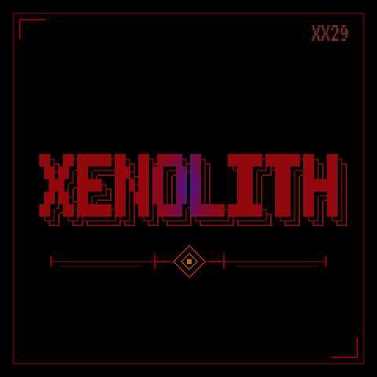

# XENOLITH

Experimental cell-based FM synthesizer for the M-VAVE FM-1.

Xenolith combines up to 64 paired oscillator cells with parallel, serial,
branching and feedback connections. It includes selectable FM laws, up to
eight-note paraphony, modulation generators, sequencing, a multimode filter,
VCA and wavefolder, digital rate/quantization controls and stereo reverb.

- [Download firmware](firmware/XENOLITH1.fwsc)
- [Windows updater ZIP](downloads/XENOLITH-Windows-updater-85079c89.zip)
- [Installation](INSTALL.md) / [Operator's Manual](docs/OPERATOR_MANUAL.md) / [Build instructions](BUILD.md)

The Windows updater requires Python 3.12 with the Windows `py` launcher, uses
the pinned FM-1 installer protocol and asks before writing. Its portable wrapper has offline tests, and its local-file installation path
was exercised on the connected device. Other firmware may erase saved patches.

The platform recognizes the original Puya and newer UC25HQ80 1 MiB flash IDs.
UC25HQ80 support is based on its manufacturer datasheet and offline tests; a
physical FM-1 of that revision has not been available for qualification.
The embedded repository and dictionary links point to this repository. No
Firmware Hub listing is claimed.

## Source and licences

The complete application and concrete modified platform/BSP sources are included.
The isolated exported source rebuilt byte-for-byte to the bundled firmware.
The combined instrument is GPL-3.0-or-later; individual framework, font and SDK
components retain their original terms. See [LICENSE](LICENSE),
[component notices](app/THIRD_PARTY.md) and [credits](app/CREDITS.md).
