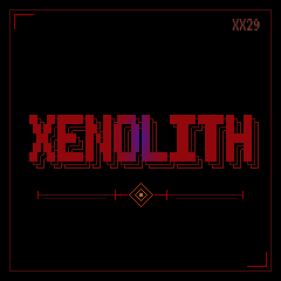

# XENOLITH

[XX29 / website and downloads](https://xx29.org/)

Experimental cell-based FM synthesizer for the M-VAVE FM-1.

Xenolith combines up to 64 paired oscillator cells with parallel, serial,
branching and feedback connections. It includes selectable FM laws, up to
eight-note paraphony, modulation generators, sequencing, a multimode filter,
VCA and wavefolder, digital rate/quantization controls and stereo reverb.

- [Download firmware](firmware/XENOLITH1.fwsc)
- [Windows x64 updater EXE](https://github.com/CaptainChronosis/XENOLITH/releases/download/v1.0/XENOLITH-Updater-1.0-Windows-x64.exe) — no Python installation
- Experimental: [macOS Apple Silicon](https://github.com/CaptainChronosis/XENOLITH/releases/download/v1.0/XENOLITH-macOS-arm64-1.0-3cf3093b.tar.gz) / [macOS Intel](https://github.com/CaptainChronosis/XENOLITH/releases/download/v1.0/XENOLITH-macOS-x64-1.0-3cf3093b.tar.gz) / [Linux x64](https://github.com/CaptainChronosis/XENOLITH/releases/download/v1.0/XENOLITH-Linux-x64-1.0-3cf3093b.tar.gz)
- [Updater source](https://github.com/CaptainChronosis/XENOLITH/releases/download/v1.0/XENOLITH-Updater-1.0-Source.zip) / [Installer SHA-256 checksums](https://github.com/CaptainChronosis/XENOLITH/releases/download/v1.0/XENOLITH-1.0-Installers-SHA256SUMS.txt)
- [Legacy Windows updater ZIP](downloads/XENOLITH-Windows-updater-3cf3093b.zip) — requires Python 3.12
- [Installation](INSTALL.md) / [Operator's Manual](docs/OPERATOR_MANUAL.md) / [Field manual PDF](https://xx29.org/manual/XENOLITH_FIELD_MANUAL.pdf) / [Build instructions](BUILD.md)

The new installers include a private Python runtime, corresponding source and
component notices. They use the pinned FM-1 installer protocol and ask before
writing. The Windows installer path was physically tested on one FM-1 on
16 November 2026: all 17 saved objects matched before and after, and 16 offline
launcher checks passed. The macOS and Linux packages are experimental: archive
checks and 19 shared wrapper checks passed, but native execution and hardware
tests have not been done. The macOS packages are not notarized.

A compatible USB-MIDI update loader is required; there is no blanket V15
prerequisite. Compatibility depends on the installed firmware and device revision.
Other firmware may erase saved patches.

The platform recognizes the original Puya and newer UC25HQ80 1 MiB flash IDs.
UC25HQ80 support is based on its manufacturer datasheet and offline tests; a
physical FM-1 of that revision has not been available for qualification.
The embedded repository and dictionary links point to this repository. No
Firmware Hub listing is claimed.

17 November 2026: V1 defaults restored to 50% ONSET / 50% SPAN. The lamp
behaviour and all other synthesis controls are unchanged. Matching firmware
source is attached to the [v1.0 release](https://github.com/CaptainChronosis/XENOLITH/releases/tag/v1.0);
the original tag archive remains the original build.

## Source and licences

The complete application and concrete modified platform/BSP sources are included.
The isolated exported source rebuilt byte-for-byte to the bundled firmware.
The combined instrument is GPL-3.0-or-later; individual framework, font and SDK
components retain their original terms. See [LICENSE](LICENSE),
[component notices](app/THIRD_PARTY.md) and [credits](app/CREDITS.md).
